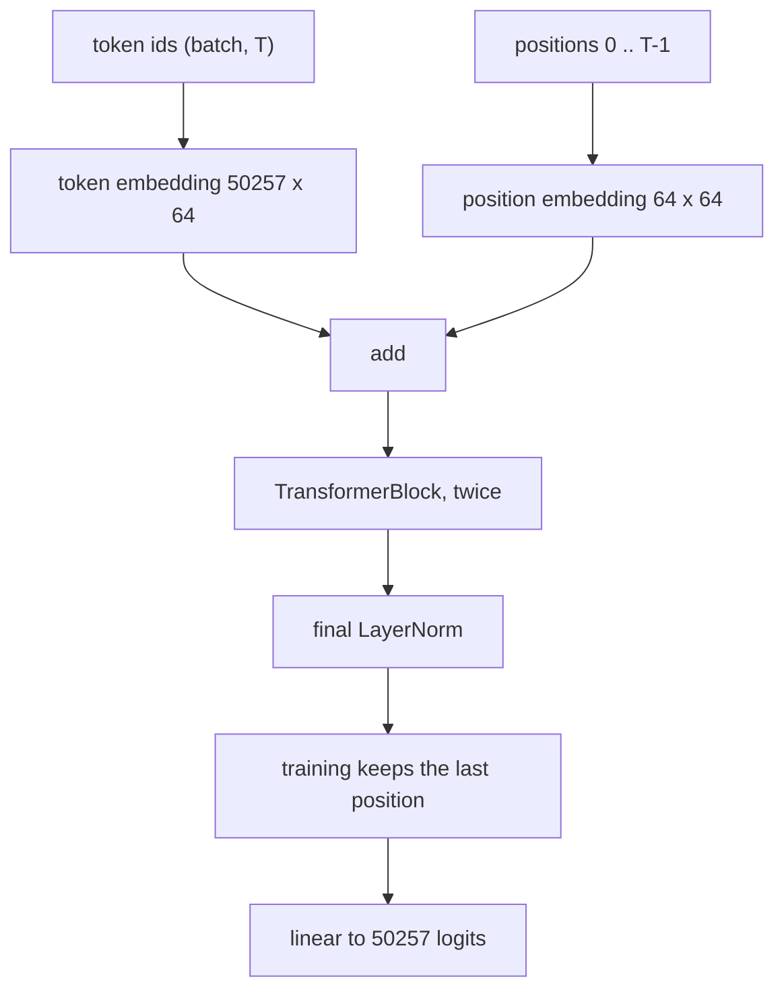
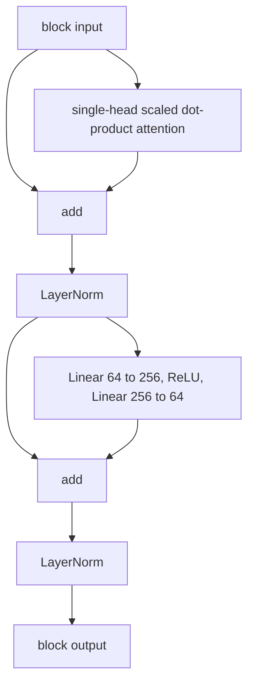

# MiniGPT

A 2-layer, single-head transformer with 6,579,025 parameters and a context length of 64 that predicts the next TinyStories token using the GPT-2 tokenizer.

## What it is and why

This is a small GPT-style language model written in PyTorch. The readable path is: tokenize text, batch a next-token target, run a short transformer, save `model.pth`, and print a continuation.

The code is set up as a short test run, not a train to convergence. `train_gpt.py` declares one epoch and then stops at optimizer step 2500. There is no validation split, no learning-rate schedule, and no saved metric.

An older model is still in the tree. `TinyLanguageModel` in `model.py` is an MLP over a fixed window of 3 tokens (`embedding_dim` 32, hidden size 128, ReLU). `train.py` is its training loop (200 epochs, Adam, learning rate 0.01). `prepare_data.py` no longer builds the `X` and `Y` tensors that loop expects (`X` and `Y` are empty), and importing `prepare_data.py` also requires the TinyStories token file. `python train.py` is not a working entry point. The model that matches the MiniGPT name is `train_gpt.py`.

## Architecture

`train_gpt.py` and `generate.py` both construct:

| | |
| --- | --- |
| Layers | 2 |
| Heads | 1 (one attention mix over the full `embed_dim`; the width is not split) |
| `d_model` | 64 |
| FFN width | 256 (`embed_dim * 4`) |
| Context length | 64 |
| Vocabulary | 50,257 (GPT-2) |
| Parameters | 6,579,025 |



Each `TransformerBlock` is post-norm. The residual is added, then normalized. The feed-forward network is `Linear(64, 256)`, ReLU, `Linear(256, 64)`. There is no dropout.



Attention in `attention.py` is query, key, and value projections, then `softmax(Q K^T / sqrt(d_model)) V`. There is no fourth output projection and no causal mask. Softmax runs over the whole current window.

The missing mask does not show the label to the model. The dataset takes 65 tokens and returns the first 64 as `x` and the last one as `y`. The target is never an input. Loss is cross-entropy on that one next token. With `return_last_only=True`, the vocab projection runs only on the last position, after both blocks and the final LayerNorm. Earlier positions still run through attention, and each of them can attend to later tokens inside the 64-token window. Their outputs are discarded before the loss.

Positions are learned absolute embeddings. Index `t` is the offset inside the current window, starting at 0. The table has 64 rows, so a longer input is out of range. Generation avoids that by keeping only the last 64 tokens. Token embeddings and the output layer are not tied.

Parameter count, using PyTorch defaults (bias on every `Linear`, affine weight and bias on every `LayerNorm`, no bias on `Embedding`):

| Piece | Count |
| --- | ---: |
| Token embedding, `50257 * 64` | 3,216,448 |
| Position embedding, `64 * 64` | 4,096 |
| One block: Q, K, V | 12,480 |
| One block: two LayerNorms | 256 |
| One block: FFN up and down | 33,088 |
| One block, total | 45,824 |
| Both blocks | 91,648 |
| Final LayerNorm | 128 |
| Output layer, `64 * 50257 + 50257` | 3,266,705 |
| **Total** | **6,579,025** |

The two vocabulary matrices are 6,483,153 of those parameters. The rest of the network, including both blocks and the position table, is 95,872.

`tokenizer.py` defines a whitespace word tokenizer and a character tokenizer. The training and generation scripts do not use them. They use `tiktoken`'s `gpt2` encoding through the `TikTokenizer` wrapper in `prepare_data.py`: `encode_ordinary` on the way in, `decode` on the way out.

## Quickstart

### Install

```bash
python -m venv .venv
source .venv/bin/activate
pip install torch tiktoken numpy pandas
```

No dependency file is checked in. Those four imports are what `prepare_data.py` and `train_gpt.py` load.

### Data

Training reads a memmap file, `train.bin`, of GPT-2 token ids stored as `uint16`. If that file is missing, `prepare_data.py` builds it on import:

1. If `/home/adarsh/Downloads/tinystories/train.csv` exists, it reads the `text` column in chunks of 100,000 rows, joins the strings with the literal characters `<|endoftext|>`, and encodes the result with `encode_ordinary`.
2. Otherwise it reads `dataset.txt` from this directory (gitignored) as one string and encodes that the same way.

`encode_ordinary` does not emit special tokens, so the joiner is ordinary byte-pair encoding of those characters. It is not GPT-2's end-of-text id (50256). That id is still a row in the embedding table because the vocabulary size is the full GPT-2 size.

The path above is absolute and points at one machine. On any other machine, either put the CSV at that path or put raw text in `dataset.txt`.

Importing `prepare_data.py` immediately memmaps `train.bin`, builds the dataset, and builds the loader. `train_gpt.py` and `generate.py` both import it, so generation also requires `train.bin` even though sampling only needs the tokenizer and `model.pth`.

Each example is 64 context tokens and the following token as the label. The loader uses batch size 256. `ChunkedRandomSampler` yields as many indexes as the dataset has windows. Each index is `torch.randint` over the full dataset, so draws repeat, and the chunk size of 1,000,000 only limits how many indexes are allocated at once. It does not restrict reads to a contiguous slice of the memmap.

### Train

```bash
python train_gpt.py
```

The script picks `cuda` when it is available, otherwise `cpu`. Optimizer is Adam at learning rate 0.001. Loss is `CrossEntropyLoss` on the single next-token logit vector. Gradients are not clipped. The seed is not set.

The epoch loop runs once. Inside it, after the update where the step index is 2500, the script breaks. A run that hits that branch performs 2501 updates (indexes 0 through 2500): 2501 * 256 = 640,256 next-token labels, and 640,256 * 64 = 40,976,384 context tokens read. Comments in `train_gpt.py` call the CSV about 1.9 GB, a full pass about 7 million steps, and this early stop about 8 million tokens. Those figures are comments. They are not measurements stored in the repo, and they do not match the arithmetic of the constants above.

Every 50 steps the script prints the step loss. After the loop it prints the average of the steps it actually ran, then writes `model.pth` (weights only). `*.pth` and `*.bin` are gitignored.

### Generate

```bash
python generate.py
```

This loads `model.pth` onto CPU, encodes the hardcoded prompt `to be`, and appends 20 tokens. Each step feeds the last 64 token ids (or fewer, if the prompt is shorter) and takes `argmax` of the last position's logits. The forward pass projects every position; only the last vector is kept. There is no temperature, top-k, or nucleus sampling. To try another prompt or length, edit `generate()` and the call at the bottom of `generate.py`. The architecture constants there are copied from `train_gpt.py` and have to stay in sync with the checkpoint.

## Results

No training log, loss curve, or generated sample is stored in this repo. The printouts from `train_gpt.py` and `generate.py` were not kept.

Add loss curve and sample generations here.

## Project structure

```
attention.py           single-head self-attention
transformer_block.py   post-norm residual block and FFN
gpt_model.py           MiniGPT: embeddings, blocks, final norm, output layer
prepare_data.py        tokenize to train.bin, memmap dataset, dataloader
train_gpt.py           train MiniGPT and save model.pth
generate.py            greedy continuation from model.pth
model.py               older 3-token MLP, TinyLanguageModel
train.py               loop for that MLP; broken against current prepare_data.py
tokenizer.py           word and character tokenizers; unused by the GPT path
test_sampler.py        times a torch.randint generator; not a model test
```

## What I learned / next steps

At a GPT-2 vocabulary and `d_model` 64, MiniGPT is an embedding table with a thin transformer on top: 6,483,153 parameters in the token embedding and the untied output layer, 95,872 everywhere else. Counting parameters from the module list makes that obvious before any training run.

The supervised signal is one token per window. Attention still mixes all 64 positions, with no mask, and 63 of those positions never receive a loss. A causal mask and a loss on every position would match the usual GPT objective and would use the same disk reads for 64 labels instead of one.

The pieces around the model have drifted. The sampler comments describe chunked reads; the sampler draws uniformly from the whole file, with replacement. `train.py` still targets an MLP and empty tensors. Train and generate duplicate the same four hyperparameters.

Next:

- Add a causal mask and compute cross-entropy at every position.
- Use multi-head attention, an attention output projection, and tied token / output weights.
- Hold out a validation slice, set a seed, and save the loss curve plus a few generations.
- Sample with temperature or top-k, and take the prompt from the command line.
- Share one config between `train_gpt.py` and `generate.py`.
- Pass the dataset path in, and encode a real end-of-text token between stories.
- Shuffle without replacement, in memmap-sized chunks.
- Repair or delete `train.py`, `model.py`, and the unused tokenizers.
